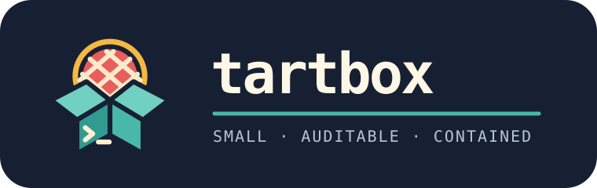

<p align="center">
  
</p>

<p align="center"><strong>Isolated macOS development VMs for coding agents.</strong></p>

<p align="center">
  <a href="#trust-boundaries">Security model</a> ·
  <a href="#install">Install</a> ·
  <a href="#use">Use</a> ·
  <a href="#ask-your-llm-to-audit-tartbox">Audit Tartbox</a>
</p>

Tartbox is a small, auditable wrapper around [Tart](https://github.com/openai/tart) for running coding agents inside isolated macOS development VMs. It is one shell script, and it deliberately keeps the security-sensitive behavior visible.

Tartbox is an independent project. It is not affiliated with or endorsed by OpenAI, Apple, Cirrus Labs, Anthropic, or the other projects it can orchestrate.

It is intended for developers who want to give Codex or Claude broad permissions in a disposable-looking development environment without giving those permissions to the whole host Mac. Tartbox does **not** make an agent harmless: the selected project directory is writable, the VM has Internet access, and the system depends on Tart, Apple's virtualization mechanisms, Softnet, the Cirrus Labs image, and the agent behaving as their implementations claim.

```text
Host Mac
│
├── $TARTBOX_DEV_ROOT/project ─── VirtioFS ──┐
│                                             │
├── Desktop / Documents / ~/.ssh ── NOT ─────┤
│                                             │
└─────────────────────────────────────────────┼────
                                              │
                                        Tart macOS VM
                                              │
                                       Codex / Claude
                                          Full Access
                                              │
                                           Softnet
                                              │
                                          Internet
                                    LAN/private blocked
```

Only an immediate child of the configured development root can be selected. For example, with the default `$HOME/Development`, `Development/foo` is allowed; the development root itself, a nested `foo/bar`, and `Desktop/foo` are refused before Tartbox clones, starts, modifies, or updates a VM. A Git repository is not required, and an empty directory is valid.

The selected directory is mounted read/write at `/Volumes/My Shared Files/workspace`. A compromised, malicious, or mistaken agent can delete or corrupt files there. Commit or back up work you cannot afford to lose.

## Trust boundaries

The primary containment boundary is the Tart VM plus the one explicit VirtioFS share and Softnet networking—not Codex or Claude's own permission prompts. Relevant components are:

- Apple's virtualization facilities used by Tart.
- [Tart](https://github.com/openai/tart), which creates, runs, shares directories with, and networks the VM.
- Tart Softnet, which provides Internet access while blocking LAN/private destinations.
- Cirrus Labs' [macOS image templates](https://github.com/cirruslabs/macos-image-templates) and [published image packages](https://github.com/orgs/cirruslabs/packages?tab=packages&q=macos-).
- The coding agent, which has broad permissions inside the VM.
- The explicitly shared project directory, which crosses the isolation boundary and is writable from both sides.

Softnet reduces network reachability; it is not a promise that Internet-connected agent execution is risk-free. Claude warns that bypassing permissions is recommended for externally sandboxed environments without Internet access. Tartbox's VM **does have Internet access**, while private/LAN access is blocked.

## Install

Requirements are an Apple-silicon Mac, Tart, Bash, and the standard macOS command-line utilities.

```sh
brew install openai/tools/tart
chmod +x tartbox
# Put tartbox somewhere on PATH, or invoke it by its path.
```

Read the script before running it. Tart/Xcode images are very large. To put them on another volume, set `TART_HOME` before bootstrap:

```sh
export TART_HOME="/Volumes/MyLargeDisk/tart"
export TARTBOX_DEV_ROOT="$HOME/Development"
```

Bootstrap offers to persist a newly chosen `TART_HOME` in `~/.zshrc`. You can instead configure it yourself first, as above.

## Bootstrap

```sh
tartbox --bootstrap
```

Bootstrap clones `ghcr.io/cirruslabs/macos-tahoe-xcode:latest` to the local gold VM `goldcopy` (both configurable), starts it, configures guest DNS, updates Homebrew, discovers known agents, and configures Codex Full Access. It reports authentication state for Codex and Claude and offers to launch an unauthenticated supported agent interactively. Tartbox never asks for, copies, or parses tokens; normal agent authentication stores credentials inside the gold VM.

Project VMs inherit that authentication state. The gold VM therefore contains reusable sensitive credentials. Do not export, distribute, or share your personal gold VM. Bootstrap refuses to overwrite an existing gold VM.

Overrides:

```sh
export TARTBOX_DEV_ROOT="$HOME/Development"
export TARTBOX_GOLD_VM="goldcopy"
export TARTBOX_BASE_IMAGE="ghcr.io/cirruslabs/macos-tahoe-xcode:latest"
```

## Use

Run Tartbox from an immediate child of the development root:

```sh
cd "$HOME/Development/my-project"
tartbox                 # Codex, GUI VM
tartbox claude          # Claude Code
tartbox --headless      # Codex without the VM window
tartbox claude --headless --name my-project-vm
tartbox --no-update     # skip this project's Homebrew refresh
```

Without `--name`, the VM name is deterministic: a `tartbox-` prefix, a sanitized project-directory name, and a hash of its resolved path. `--name` changes only the Tart VM name. It does not change or relax workspace validation, and accepts only a conservative set of letters, digits, dots, underscores, and hyphens. Tartbox refuses to reuse a custom-named VM while it is already running because it cannot safely verify that VM's existing directory share; stop it first so the selected workspace is mounted explicitly.

Codex launches in the shared workspace with `approval_policy = "never"` and `sandbox_mode = "danger-full-access"`. Claude changes into that workspace and launches with `--dangerously-skip-permissions`. These settings remove the agents' normal permission boundary **inside the VM**.

Tartbox detects `codex`, `claude`, `gemini`, `aider`, `opencode`, `goose`, `amp`, `cursor-agent`, and `copilot`. Only Codex and Claude currently have verified authentication and launch integrations. Detection does not imply support.

## Updates and scheduled maintenance

By default, a project start configures DNS and runs `brew update`, `brew upgrade`, and `brew cleanup` in the guest. Use `--no-update` to skip that project update. Refresh the stopped or running gold image explicitly with:

```sh
tartbox --update-gold
```

Scheduled maintenance is opt-in:

```sh
tartbox --schedule-update          # weekly is the default
tartbox --schedule-update weekly
tartbox --unschedule-update
```

This installs the user LaunchAgent `~/Library/LaunchAgents/dev.tartbox.update-gold.plist`, scheduled for Sunday at 03:00 local time. It records the effective Tartbox settings at installation time and writes output under `~/Library/Logs/Tartbox`. The command prints these paths before creating anything. No privileged daemon or root access is used. Unscheduling removes the plist and unloads it; logs are deliberately retained and may be deleted manually.

The Cirrus Xcode image has included `applesimutils` from the third-party `wix/brew` tap. Homebrew may warn that its formula is not trusted during an upgrade. Tartbox leaves that warning visible and does not automatically trust any tap; review the tap and image provenance before changing Homebrew's trust settings.

## Doctor and VM lifecycle

```sh
tartbox --doctor
```

Doctor is read-only. It reports the Tart version, effective storage and image settings, gold VM state, scheduled-maintenance state, and—when the gold VM is already running—known-agent discovery and supported-agent authentication state. It does not start the VM or expose credential contents.

Project VMs persist after the agent exits and are reused on the next run. Tartbox does not automatically stop or delete them:

```sh
tart stop <vm>
tart delete <vm>
```

Deletion is an explicit Tart operation. Take care: deleting a VM also deletes state that exists only inside it, but does not delete the separately shared host project directory.

## What Tartbox changes on your Mac

Depending on the commands you choose, Tartbox can:

- Create large Tart images in `TART_HOME` (or Tart's default `~/.tart`), including the gold VM and persistent project clones.
- Append an `export TART_HOME="..."` line to `~/.zshrc` if you choose a custom location during bootstrap and no export already exists.
- Create temporary Tart startup logs under `${TMPDIR:-/tmp}`.
- Create `~/Library/LaunchAgents/dev.tartbox.update-gold.plist` and `~/Library/Logs/Tartbox` only when you opt into scheduling.
- Read and write the selected project directory through Tart's directory share while its project VM runs.

Inside VMs it changes DNS settings with `sudo networksetup`, updates Homebrew packages, writes Codex's `~/.codex/config.toml`, and stores authentication created by the agents' own login flows. Tartbox does not run host commands with `sudo`.

## What Tartbox does NOT do

- It does not mount the whole home directory, Desktop, Documents, `~/.ssh`, host credential/config directories, or Docker sockets.
- It does not copy SSH keys or host agent credentials into a VM.
- It does not ask for or directly manage agent tokens.
- It does not automatically trust Homebrew taps.
- It does not automatically delete project VMs.
- It does not install a privileged background daemon; optional maintenance is a user LaunchAgent.
- It does not make Codex or Claude their own primary sandbox boundary. They run unrestricted inside the VM.
- It does not protect the explicitly shared project directory from the agent.

## Ask your LLM to audit Tartbox

Before running the project, give another model the repository and this prompt:

```text
Audit this Tartbox repository before I run it. Treat the source code as authoritative. Do not trust claims in the README unless they match the implementation.

1. Read the complete `tartbox` shell script and `README.md`.
2. Explain in plain language every persistent change Tartbox can make to the host.
3. Identify every host path shared with a VM, including whether each share is writable.
4. Identify every command executed with sudo, if any, and say whether it runs on the host or in a guest.
5. Explain networking behavior and what can reach the Internet, LAN, and private addresses.
6. Explain where credentials live and whether Tartbox itself handles or copies them.
7. Identify every destructive operation, including indirect operations invoked through Tart or Homebrew.
8. Explain the consequences of Codex and Claude running with unrestricted permissions.
9. Identify all background or scheduled behavior, its trigger, configuration file, logs, and removal path.
10. Point out anything in the implementation that contradicts or exceeds the README.
11. Flag shell-code patterns that could unexpectedly affect files outside the intended project directory, especially quoting, command substitution, path validation, symlinks, environment variables, and background processes.
12. Give an overall risk assessment without assuming the README is correct.

Pay particular attention to whether workspace refusal occurs before any VM clone, start, modification, or update; whether a custom VM name can alter the mounted host path; and whether any host directories other than the selected project are exposed to a VM.
```

## License and upstream references

Tartbox itself is licensed under the [MIT License](LICENSE) and is provided as-is, without warranty. It is a personal project shared in case others find it useful. There is no support commitment or roadmap, and no guarantee that issues, pull requests, or feature requests will be reviewed or accepted.

Tartbox is only a wrapper and orchestration tool. It does not incorporate or redistribute Tart or the Cirrus Labs images. [Tart](https://github.com/openai/tart), the [Cirrus Labs image packages](https://github.com/orgs/cirruslabs/packages?tab=packages&q=macos-), and the [Cirrus Labs image templates](https://github.com/cirruslabs/macos-image-templates) are separate projects with their own licenses and terms. Review those upstream projects as part of your own security and licensing assessment.
